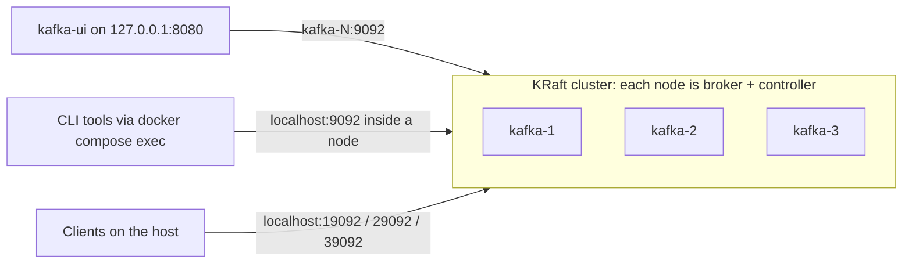

# 00 — Kafka Fundamentals

A 3-node Apache Kafka cluster in KRaft mode (no ZooKeeper), used to explore topics, partitions, replication, consumer groups, offsets, and failover from the command line. Integration tests verify how message keys map to partitions.

## Problem

When services call each other directly over HTTP, they are coupled in time. If the receiver is down or slow, the caller fails or waits too. A message broker sits between them: the producer writes an event and moves on, and consumers read it when they are ready.

Kafka does not delete a message once it is consumed. It stores events in an append-only log for a retention period, and every consumer group tracks its own position (offset). As a result, many independent services can read the same events, and any of them can replay history.

This module answers four questions:

- How does Kafka split a topic for parallelism, and what does it guarantee about ordering?
- How do independent consumer groups read the same data?
- What happens to reads and writes when a broker dies?
- Who elects leaders when there is no ZooKeeper?

## Architecture



| Listener | Port | Used by |
|---|---|---|
| `PLAINTEXT` | 9092 | Containers on the Compose network (`kafka-N:9092`) |
| `CONTROLLER` | 9093 | KRaft controller quorum traffic between nodes |
| `EXTERNAL` | 9094, published as 19092 / 29092 / 39092 on 127.0.0.1 | Clients running on the host |

Key settings:

- Static controller quorum: `1@kafka-1:9093,2@kafka-2:9093,3@kafka-3:9093`
- Automatic topic creation is disabled, so a typo in a topic name fails instead of silently creating a new topic.
- Each Kafka node runs with a 512 MB heap and a 1.5 GB container limit. Kafka UI is limited to 512 MB.
- `restart: "no"` keeps killed containers down during experiments.

The demo topic `orders` has 3 partitions and a replication factor of 3:

| Partition | Leader | Replicas (first = preferred leader) |
|---|---|---|
| 0 | 1 | 1, 2, 3 |
| 1 | 2 | 2, 3, 1 |
| 2 | 3 | 3, 1, 2 |

## How to run

Requirements: Docker with Compose v2, and the .NET 10 SDK for the tests.

```
cd 00-kafka-fundamentals
docker compose up -d
docker compose ps
```

All three Kafka nodes should be `healthy`. Kafka UI is available at http://127.0.0.1:8080.

The CLI tools run inside a broker container. `KAFKA_HEAP_OPTS=-Xmx256m` keeps the extra JVM started by each tool small.

Check the controller quorum:

```
docker compose exec -e KAFKA_HEAP_OPTS=-Xmx256m kafka-1 /opt/kafka/bin/kafka-metadata-quorum.sh --bootstrap-server localhost:9092 describe --status
```

Create the topic and inspect it:

```
docker compose exec -e KAFKA_HEAP_OPTS=-Xmx256m kafka-1 /opt/kafka/bin/kafka-topics.sh --bootstrap-server localhost:9092 --create --topic orders --partitions 3 --replication-factor 3
docker compose exec -e KAFKA_HEAP_OPTS=-Xmx256m kafka-1 /opt/kafka/bin/kafka-topics.sh --bootstrap-server localhost:9092 --describe --topic orders
```

Produce a keyed message (`key:value`):

```
echo order-1:placed| docker compose exec -T -e KAFKA_HEAP_OPTS=-Xmx256m kafka-1 /opt/kafka/bin/kafka-console-producer.sh --bootstrap-server localhost:9092 --topic orders --reader-property parse.key=true --reader-property key.separator=:
```

Consume as a consumer group:

```
docker compose exec -e KAFKA_HEAP_OPTS=-Xmx256m kafka-1 /opt/kafka/bin/kafka-console-consumer.sh --bootstrap-server localhost:9092 --topic orders --group notification-service --from-beginning --timeout-ms 10000 --formatter-property print.key=true --formatter-property print.partition=true
```

Inspect group offsets and lag:

```
docker compose exec -e KAFKA_HEAP_OPTS=-Xmx256m kafka-1 /opt/kafka/bin/kafka-consumer-groups.sh --bootstrap-server localhost:9092 --describe --group notification-service
```

Stop the cluster:

```
docker compose down
```

`docker compose down` keeps the data in named volumes. `docker compose down -v` deletes it.

## Scenarios

### 1. Keys, partitions, and ordering

Seven keyed messages produced with the CLI landed like this:

| Partition | Messages |
|---|---|
| P0 | `order-2 placed`, `order-3 placed`, `order-2 paid` |
| P1 | `order-1 placed`, `order-1 paid`, `order-1 shipped` |
| P2 | `order-4 placed` |

- The same key always goes to the same partition, so all events of one order stay in order.
- A partition is shared by many keys. `order-2` and `order-3` both live in P0.
- Ordering is guaranteed only within a partition, not across the topic.
- Offsets are per partition. Every partition has its own offset 0.

### 2. Pub/sub with consumer groups

The groups `notification-service` and `payment-service` each read all messages independently. Consuming did not remove anything from the log.

Running the consumer again with `--from-beginning` returned nothing. `--from-beginning` (like `auto.offset.reset`) only applies when a group has no committed offset. A group that has already committed resumes from that offset.

### 3. Replay with offset reset

```
docker compose exec -e KAFKA_HEAP_OPTS=-Xmx256m kafka-1 /opt/kafka/bin/kafka-consumer-groups.sh --bootstrap-server localhost:9092 --group notification-service --topic orders --reset-offsets --to-earliest --dry-run
```

- With `--execute` instead of `--dry-run`, the group re-read all seven messages.
- `--topic orders:1 --to-offset 1` re-read only `order-1 paid` and `order-1 shipped`. Resetting one partition does not affect the others.
- Offsets can only be reset while the group has no active members.
- Replay means the same message is processed twice, so consumers must be idempotent (see module 03).

### 4. Broker failure: kill one of three nodes

```
docker compose kill kafka-2
```

Observed results:

- kafka-2 had been the controller leader, and leadership moved to kafka-1 with a new epoch.
- P1, which kafka-2 had led, got a new leader on kafka-3. P0 and P2 kept their leaders.
- The ISR (in-sync replicas) of every partition shrank to the two live nodes. `Replicas` did not change, because it is the assignment plan, while ISR is the current state.
- Producing `order-5 placed` still worked, and a new group read all eight messages. No data was lost.

After `docker compose start kafka-2`:

- kafka-2 fetched the messages it had missed, and the ISR returned to `1,2,3`.
- Automatic leader rebalancing moved P1's leadership back to kafka-2, its preferred leader. This changed only metadata. No data was copied.
- The controller stayed on kafka-1. A Raft leader keeps its role until it fails. There is no "preferred" controller.

### 5. Quorum loss: two of three nodes down (not run, expected behavior)

This scenario was reasoned through, not executed. With only one of three voters alive, the controller quorum cannot reach a majority (2 of 3), so no metadata change can be committed:

- Partitions led by the dead brokers cannot elect new leaders, so they are unavailable.
- Topic creation and ISR changes fail.
- The surviving broker may still serve reads for partitions it leads, using its last known metadata.
- Writes with `acks=all` are expected to time out. Shrinking the ISR is itself a metadata change, so the leader keeps waiting for followers that never respond.

Refusing to act without a majority is what prevents split brain. In CAP terms, Kafka chooses consistency over availability here.

## Tests

`tests/KafkaFundamentals.Tests` uses xUnit and Testcontainers to start a single-node `apache/kafka:4.3.1` broker. One container is shared by the whole test class through `IClassFixture`, and each test creates its own topic so that tests stay isolated.

| Test | What it proves |
|---|---|
| `Produce_ThenConsume_ReturnsSameMessage` | The broker starts, a host client can connect, and a message makes the round trip |
| `SameKey_AlwaysLandsOnSamePartition_AndKeepsOrder` | All `order-1` events land in one partition in send order, even with other keys interleaved and with a second producer instance |
| `DifferentKeys_SpreadAcrossPartitions` | 20 keys use more than one of the 3 partitions |

```
dotnet test 00-kafka-fundamentals/tests/KafkaFundamentals.Tests --logger "console;verbosity=detailed"
```

Distribution printed by the third test, identical across runs:

```
P0: 8 keys (order-2, order-6, order-9, order-12, order-13, order-15, order-18, order-19)
P1: 4 keys (order-1, order-5, order-8, order-16)
P2: 8 keys (order-3, order-4, order-7, order-10, order-11, order-14, order-17, order-20)
```

The split is 8/4/8 and not 7/7/6, because the partitioner does not balance load. It computes `hash(key) % partitions` for each key separately. Since the hash is deterministic, the result is the same on every run.

The CLI and the .NET client disagree on `order-3`: the CLI (Java client, murmur2 hash) put it in P0, and Confluent.Kafka (librdkafka, CRC32 hash) put it in P2. Services written in different languages that produce to the same topic need the same partitioner if they depend on per-key ordering.

## Trade-offs

- **Combined broker and controller nodes:** fewer containers and less memory, but a broker under heavy load can slow down the controller on the same JVM.
- **Three nodes:** the smallest cluster that survives one failure, both for the controller quorum and for topics with a replication factor of 3.
- **Plaintext listeners without authentication:** acceptable only because everything is bound to 127.0.0.1.
- **Default `min.insync.replicas=1` on `orders`:** with `acks=all`, a write can succeed after only the leader has stored it. Module 03 raises it to 2 and shows the difference.
- **Kafka UI pinned to v1.5.0:** this version has known dependency CVEs, so it is bound to localhost only.

## What I would do differently in production

- Run dedicated controller nodes (3 or 5) separately from the brokers.
- Use `acks=all` with `min.insync.replicas=2` for topics with a replication factor of 3.
- Enable TLS, SASL authentication, and ACLs.
- Spread replicas across availability zones with `broker.rack`.
- Alert on under-replicated partitions, offline partitions, and consumer lag (module 10).
- Size memory for the OS page cache, not only the JVM heap, since Kafka relies on the page cache for reads.
- Manage the cluster with an operator such as Strimzi instead of hand-written Compose files (module 11).

## What I learned

- Ordering is per partition. A key is pinned to a partition, but that partition is shared with other keys.
- Kafka does not deduplicate by key. When a group received nothing, the reason was its committed offset.
- `Replicas` is the plan and `Isr` is the reality. Followers pull data from the leader. They are not pushed to.
- Changing a leader is a metadata update. Moving data requires partition reassignment.
- There are two kinds of leaders: one controller leader for cluster metadata, and one leader per partition for data.
- A killed broker does not get the messages written while it was down until it restarts and fetches them.
- Without a controller majority, the cluster refuses to change metadata. This is a deliberate choice that prevents split brain.