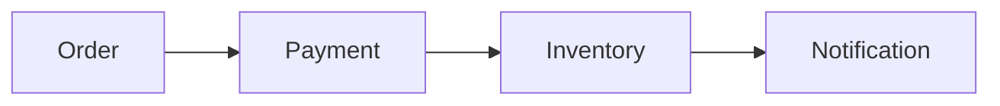

# event-driven-playground

Small, focused demo projects for learning messaging and event-driven architecture hands-on: Kafka, RabbitMQ, Redis Streams, schema registries, the outbox pattern, sagas, Kafka Streams, observability, and Kafka on Kubernetes.

Every module covers one concept, runs on its own with Docker Compose, and includes failure experiments and integration tests. Everything is free, local, and open source.

## The domain

All modules use the same small e-commerce flow, so you can compare tools and patterns on the same problem.



## Modules

| # | Module | Topics | Status |
|---|---|---|---|
| 00 | [kafka-fundamentals](00-kafka-fundamentals/) | Brokers, topics, partitions, replication, ISR, KRaft, consumer groups, offsets, failover | ✅ Done |
| 01 | microservices-sync-pain | Sync HTTP between services, tight coupling, cascading failure, retries and circuit breakers, distributed transactions | ⬜ Planned |
| 02 | producer-consumer | Keys and partitions, ordering, consumer groups, offsets, rebalancing | ⬜ Planned |
| 03 | reliability | acks, min.insync.replicas, idempotent producer, delivery semantics, idempotent consumer, retry topic, DLQ | ⬜ Planned |
| 04 | rabbitmq-vs-kafka | Exchanges, queues, routing, DLX, Kafka share groups (KIP-932) | ⬜ Planned |
| 05 | redis-streams | Streams, consumer groups, XACK, pending entries, Pub/Sub | ⬜ Planned |
| 06 | schema-registry | Avro or Protobuf, schema evolution, compatibility rules | ⬜ Planned |
| 07 | outbox-cdc | Dual-write problem, transactional outbox, polling publisher, Debezium | ⬜ Planned |
| 08 | saga | Choreography vs orchestration, compensating transactions, a Java service | ⬜ Planned |
| 09 | kafka-streams | KStream vs KTable, joins, windowing, state stores, exactly-once | ⬜ Planned |
| 10 | observability | Prometheus, Grafana, consumer lag alerts, OpenTelemetry tracing through Kafka headers | ⬜ Planned |
| 11 | kubernetes | kind, Strimzi, deploying a .NET service | ⬜ Planned |

## Learning path

The modules are meant to be read in order. Module 01 shows the problems of synchronous service-to-service calls without a broker. Modules 02 to 06 introduce messaging tools and their guarantees. Modules 07 and 08 come back to the distributed transaction problem from module 01 and solve it. Modules 09 to 11 cover stream processing and operations.

## Tech stack

| Tool | Version |
|---|---|
| Apache Kafka (`apache/kafka`, KRaft mode) | 4.3.1 |
| Kafka UI (`ghcr.io/kafbat/kafka-ui`) | v1.5.0 |
| .NET SDK | 10.0 (pinned in `global.json`) |
| Confluent.Kafka | 2.16.0 |
| Testcontainers for .NET | 4.16.0 |
| xUnit | 2.9.3 |

Every image tag and package version is pinned. Java and Spring Boot are used only where they fit best: Kafka Streams and one service in the saga module.

## Running a module

Each module has its own `docker-compose.yml` and README and does not depend on other modules.

```
cd 00-kafka-fundamentals
docker compose up -d
```

Run one module at a time. Each module is sized to stay under about 8 GB of RAM in total.

### Requirements

- Docker Desktop (on Windows, with the WSL2 backend)
- .NET 10 SDK
- Java 21 or later, for modules 08 and 09 only

On Windows, limit WSL2 memory in `%UserProfile%\.wslconfig`. Shell scripts that run inside containers must keep LF line endings, which `.gitattributes` enforces.

## Repository layout

```
event-driven-playground/
├── 00-kafka-fundamentals/   one folder per module, each with its own compose file, code, tests, and README
├── docs/
│   └── interview-qa.md      interview questions collected from every module
├── global.json              pins the .NET SDK
└── .gitattributes           line-ending rules
```

## Interview notes

[docs/interview-qa.md](docs/interview-qa.md) collects common interview questions for each module, with an outline of a good answer.